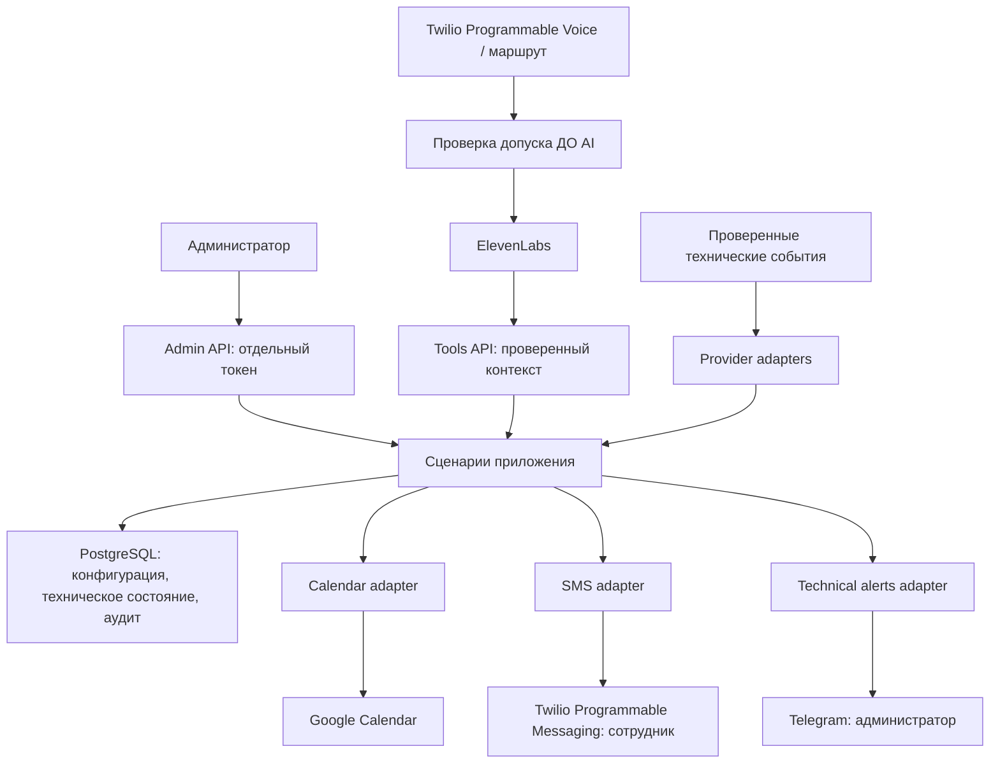

# Архитектура модульного backend

Статус: **проект технического решения v0.1**. Основания: D-023–D-027, D-043, D-051, D-055–D-058, D-065–D-066, D-069. Не подтверждает реализации или готовности внешних контрактов.

## 1. Схема ответственности

Стрелка допуска — требование, **не доказанный механизм Twilio/ElevenLabs**. Нативная интеграция ElevenLabs с Twilio может подключать агента напрямую; такой маршрут нельзя использовать, если он не позволяет проверить допуск и безопасно отказать до старта AI. Если выбранный способ (Twilio Studio/Function, SIP-транк или иной) этого не обеспечивает, маршрут не допускается к пилоту. Новая телефония/прокси не добавляется молча: потребуется отдельное решение.

## 2. Модули и границы

| Модуль | Владеет | Не должен делать |
| --- | --- | --- |
| `tenants` | Настройки, режим, привязки провайдеров, услуги, расписание | Хранить клиентов или копии визитов |
| `calls` | Проверенный контекст, допуск, активность звонка, однократное завершение | Принимать полномочия из произвольных аргументов LLM |
| `access` | Пилот, административная пауза, правила допуска и расход | Создавать визиты или автоматически активировать оплату |
| `scheduling` | Даты, рабочие интервалы, праздники, расчёт слотов | Объявлять неизвестную длительность подходящим слотом |
| `bookings` | Создание, журнал намерения, сериализация и сверка | Дублировать неизвестный внешний запрос |
| `relay` | Единственная логическая передача заявки сотруднику | Вести теневой календарь/архив заявок |
| `notifications` | SMS, временные повторы, эксплуатационные сигналы | Менять успешный визит на отказ при ошибке SMS |
| `audit` | Разрешённые поля, шифрование, чтение и ретенция | Сохранять полные HTTP-ответы или метаданные «на всякий случай» |

`access` — предлагаемое выделение общего механизма из модуля звонков, чтобы позднее добавить платные условия. Это не реализация биллинга. Точные имена директорий вторичны; циклические зависимости между модулями не допускаются.

### Направление зависимостей

HTTP/controllers → application use cases → доменные правила и порты.

Адаптеры реализуют порты. Доменные правила не импортируют SDK провайдеров, Express, request/response и переменные окружения. PostgreSQL используется через узкие repositories и транзакционные операции, а не через произвольные запросы из controllers.

Для первого релиза достаточно одного репозитория, приложения и PostgreSQL. Redis, брокер сообщений, микросервисы и распределённый аудиошлюз не являются согласованными зависимостями.

## 3. Порты внешних систем

Проект внутренних интерфейсов, **не названия методов реальных SDK**:

- `CallContextResolver`: получить доверенные `tenant_id`, внутренний `call_id`, привязку сессии. Номер контакта не является полномочием.
- `ProviderEventVerifier`: проверить подлинность/возраст/повторы, извлечь только разрешённые технические сведения без архива тела.
- `CalendarPort`: занятость; создание по стабильному внешнему ID; чтение результата в исходном календаре. Перенос/удаление сейчас не реализуются.
- `SmsPort`: отправить из памяти; классифицировать результат как принятие, подтверждённый временный/постоянный отказ или неизвестный исход. Сверка/идемпотентность — только если реально поддержаны.
- `TechnicalAlertPort`: безопасное сообщение администратору без данных обращения.
- `Clock`, `HolidayCalendar`, `SecretProvider`: контролируемое время, заменяемый источник праздников и секретов.

Возвращаемые ошибки содержат разрешённые коды, не сырые payload/тексты провайдеров. Возможность каждой операции и классификация ответов проходят проверку в [трекере](../trackers/track-backend-validation.md).

## 4. Состояние и конкурентность

- Разные автосервисы обслуживаются независимо. Не использовать общий глобальный «текущий звонок».
- Изменение допуска/расхода одного автосервиса выполняется атомарно в PostgreSQL. Проверка и изменение не разделяются на несвязанные запросы.
- Ограничение активных разговоров применяется между процессами, а не только в памяти Node.js.
- Для Calendar один автосервис имеет не более одной незавершённой операции создания. Межпроцессный постоянный шлюз переживает рестарт.
- SQL-транзакции короткие; внешние HTTP-запросы не выполняются под долгой SQL-транзакцией.
- Lease определяет локального владельца, но не отменяет действие Google и не разрешает новую бронь автоматически.
- Обновления конфигурации, влияющие на незавершённое бронирование, не должны подменять его исходный календарь и параметры сверки. Предлагается отклонять конфликтующее изменение до разрешения операции.

Фоновые задачи: сверка неизвестных Calendar-операций, удаление истёкших данных, обнаружение окончания пилотов, обслуживание временных повторов/сигналов. Запуск нескольких экземпляров не должен создавать повторные внешние действия; координация через БД. Простой `setInterval` без координации этого не обеспечивает.

## 5. Точки расширения, не новые функции

| Будущее | Что отделить сейчас | Чего не реализовывать сейчас |
| --- | --- | --- |
| Больше автосервисов | Явный tenant-контекст, индексы, независимые блокировки | Инфраструктуру для неизвестной нагрузки |
| Больше AI-звонков | Политику вместимости и записи индивидуальных допусков | Запуск второго разговора при лимите 1 |
| Больше визитов | Модель ограничений доступности от алгоритма интервалов | Посты/мультикалендарь/распределение исполнителей |
| Перенос/отмена | Отдельные use cases и общий журнал операций | Пустые действующие endpoints или доступ без проверки |
| Платное обслуживание | Право доступа и расход отдельно от условий пилота | Периоды оплаты и банковские интеграции |
| Самообслуживание | Use cases отдельно от admin transport и полномочий | Аккаунты клиентов/OAuth/панель |
| Компенсация минут за техсбои | Отдельный механизм корректировок баланса в модуле `access` (D-075) | Админские endpoints возврата/сброса минут в 1-м релизе |

## 6. Критерий готовности проекта

По каждому внешнему действию должны быть определены источник полномочий, проверка входа, момент фиксации намерения, доказательство успеха/отказа, неизвестный исход, допустимый повтор, срок состояния и поведение после его удаления. Неизвестный внешний контракт остаётся блокером, а не заполняется предположением.
